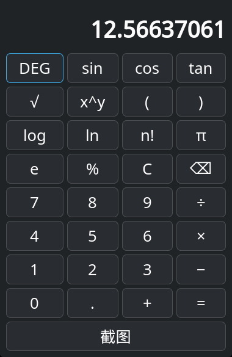

# calc4-asm-calculator

**x86-64 汇编语言实现的 GTK4 科学计算器**（GNU as，Intel 语法，约 1450 行纯汇编）

用纯 x86-64 汇编语言调用 GTK4/C 库，实现完整科学计算器功能。项目展示了汇编与 C 生态互操作、System V AMD64 ABI、shunting-yard 表达式解析算法在寄存器级机器码中的落地。

## 功能特性

- **33 个按钮 + 键盘双输入**：完整科学计算器布局
- **科学函数**：`sin` `cos` `tan` `√` `x^y` `log` `ln` `n!` `π` `e`
- **表达式模型**：shunting-yard 算法将中缀表达式转为 RPN 后求值，支持任意层括号
- **DEG/RAD 角度模式切换**：一键切换三角函数角度单位
- **窗口截图导出**：一键将计算器窗口保存为 PNG（`import` 命令）
- **双精度浮点运算**（IEEE 754 double）
- **错误处理**：除零、括号不匹配、负数阶乘、NaN 域错误均显示"错误"

## 界面



## 构建与运行

依赖：`gtk4`（GTK4 开发包）、`glib2`、libm

```bash
# 编译链接
as --64 calc4.asm -o calc4.o
gcc -no-pie calc4.o -o calc4 $(pkg-config --libs gtk4) -lm

# 运行（X11 环境）
./calc4
```

## 操作说明

- **鼠标点击**或**键盘输入**均可操作
- 键盘快捷键：数字 `0-9`、运算符 `+ - * /`、`.`、`=`、`( )`、`^`、`s/c/t`（sin/cos/tan）、`r`（√）、`l/n`（log/ln）、`p`（π）、`Esc`（清除）、`Backspace`（退格）
- 按钮布局（4 列 × 9 行）：

```
DEG  sin  cos  tan
√    x^y  (    )
log  ln   n!   π
e    %    C    ⌫
7    8    9    ÷
4    5    6    ×
1    2    3    −
0    .    +    =
[       截图       ]
```

## 测试与验证

- **逻辑层**：37 项单元测试全部通过（基础四则、小数、括号、全部科学函数、常量、复合表达式、错误处理、DEG/RAD 切换、退格、等号后重新输入等）
- **GUI 端到端**：真实 X11 点击冒烟测试 39/39 次全部送达并验证正确
- 验证用例：`12+34=46`、`sin(30)+cos(60)=1`、`(2+3)^2=25`、`5÷0=错误`、`π×2²=12.56637061`

## 技术要点（踩坑沉淀）

- **SysV 栈对齐铁律**：GUI 信号回调由 libffi 以标准 ABI 调用（入口 rsp≡8 mod 16），回调内再调用时 push 次数必须为奇数，否则下游 `g_vasprintf` 的 SSE 指令在未对齐栈上 SIGSEGV；且 C 单元测试不会触发此问题，只有真实 GUI 信号才会暴露
- **表驱动按钮**：33 项按钮表（label/col/row/append/action），条目字节数必须与代码步进严格一致，多 4 字节 pad 即指针错位
- **GTK3→GTK4 迁移**：无参 `gtk_init`/`gtk_window_new`、`gtk_window_set_child`、`g_main_loop`、`GtkEventControllerKey`、margin 替代 border_width
- **词法陷阱**：小数点 `'.'`(0x2E) 判断必须先于数字范围检查；shunting-yard 分派须先处理低编号括号 token；「无前驱」哨兵用 -1 而非 0

## 许可

MIT License